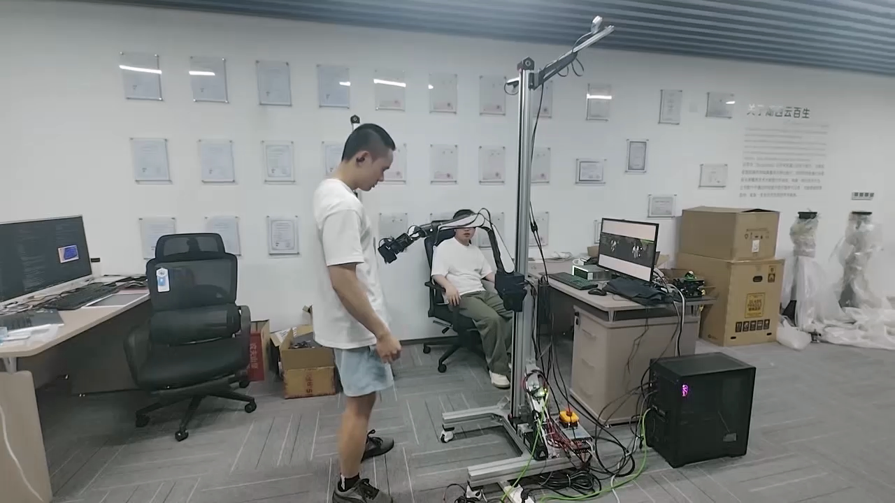
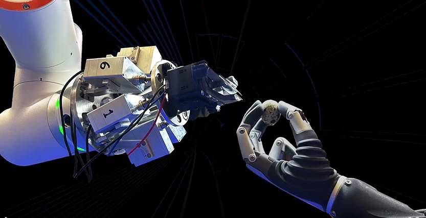
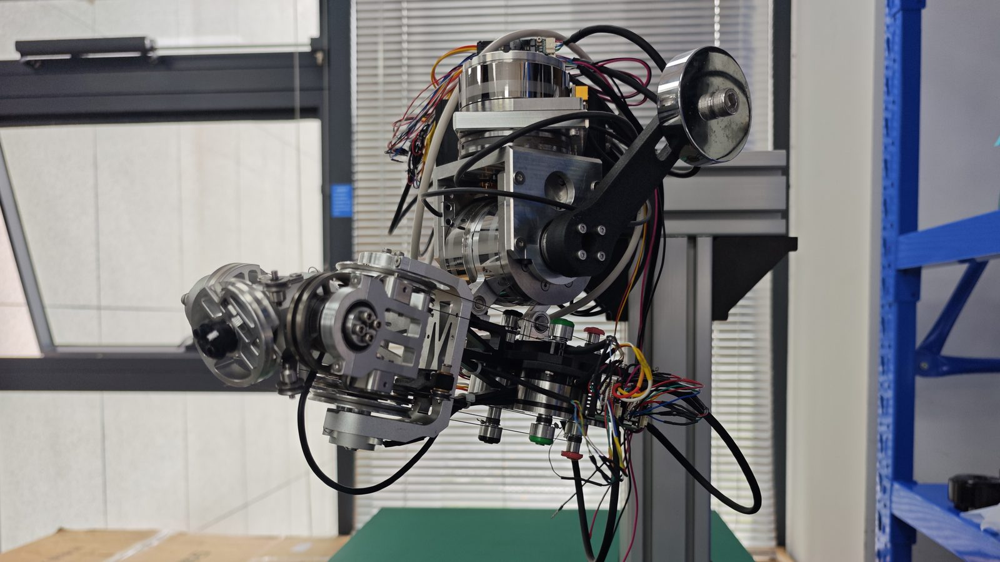
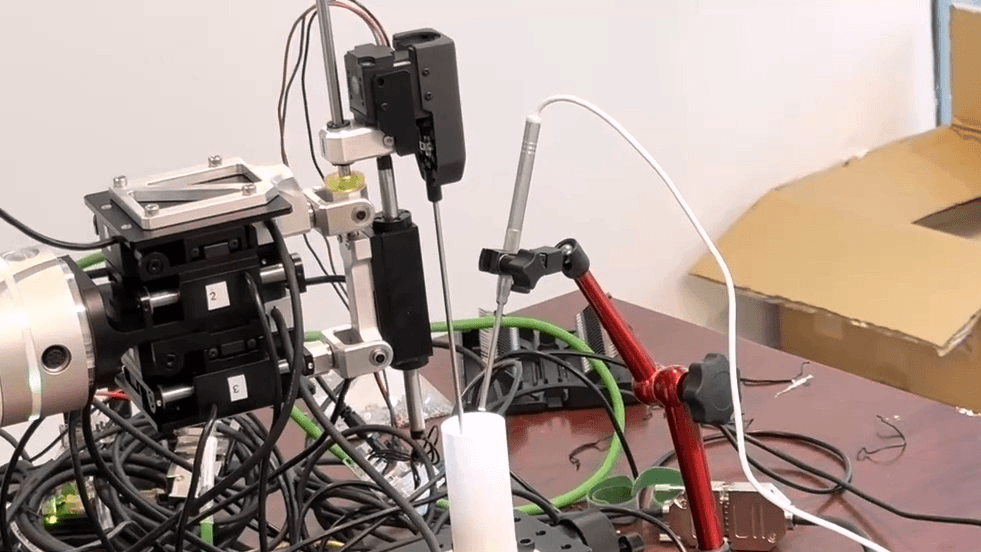
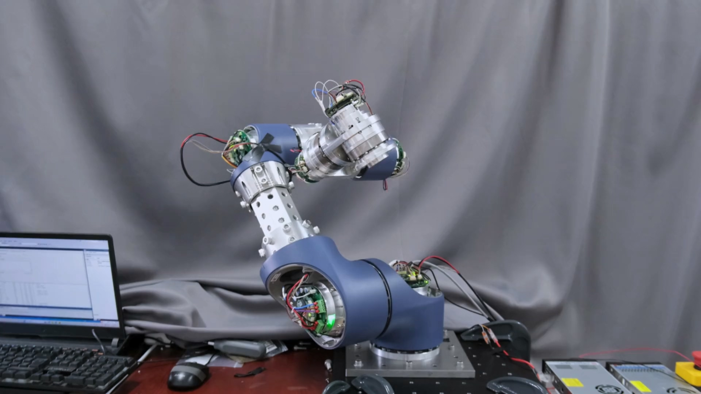
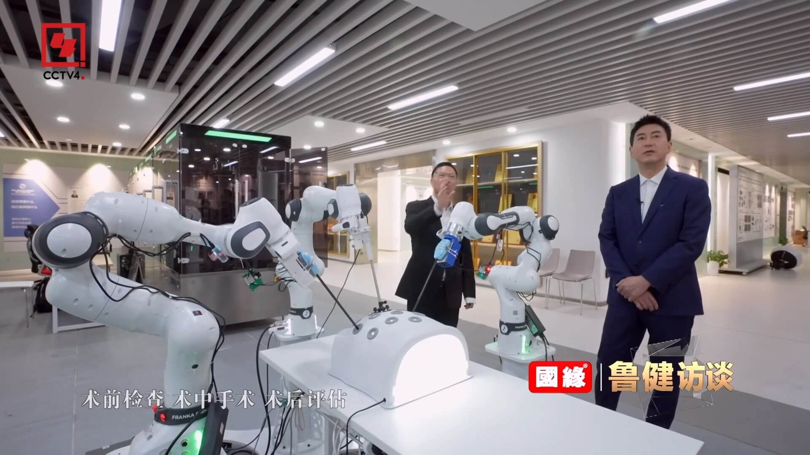
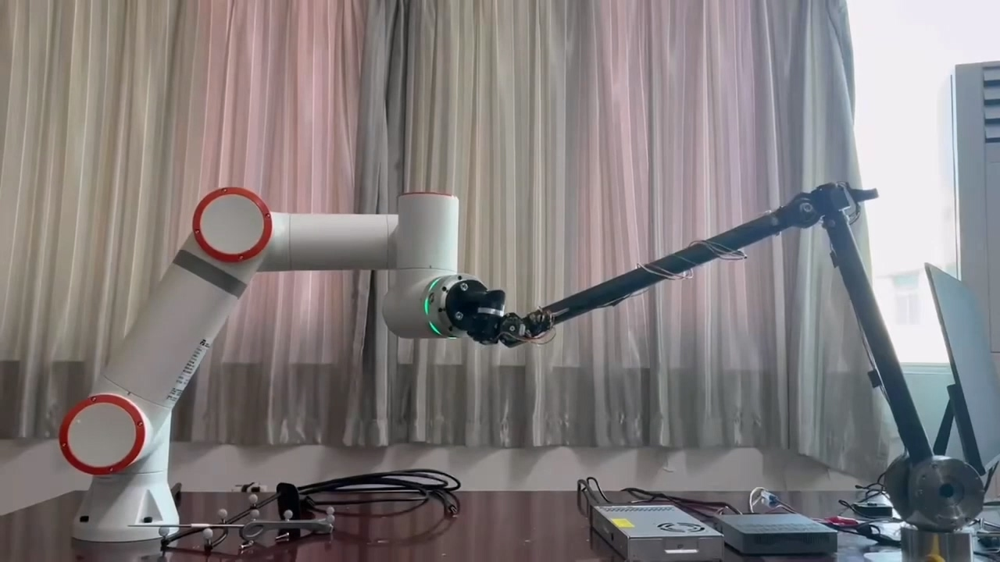








<!-- Full-stack robotic system design and development, with a focus on surgical robotics and legged robots. -->

# 📖 Educations

**University of Illinois at Urbana-Champaign (UIUC)**, Urbana, IL  
Master of Engineering in Mechanical Engineering | Sep 2021 – Jan 2023 | GPA: 3.79/4.00

**Israel Institute of Technology (Technion)**, Haifa, Israel  
Bachelor of Science in Mechanical Engineering | Aug 2017 – Jul 2021 | GPA: 86/100

# 🤖 Portfolio

<video muted loop playsinline preload="auto" class="project-video">
  <source src="/videos/project_bath.mp4" type="video/mp4">
</video>

**Robotic Bathing System (internal codename: Triton)**

<!-- [**Code**](https://github.com/) [**Video**](https://youtube.com/) [**Demo**](https://demo.com/) -->
- Led end-to-end development of an assistive bathing robot, owning system architecture and technical roadmap
- Defined and drove multiple design approaches, conducting system-level trade-offs and selecting the final solution
- Personally designed and integrated the end-effector with brush module, motor drive, gearbox, and force sensing, and validated the overall mechanical structure

<video muted loop playsinline preload="auto" class="project-video">
  <source src="/videos/project_stewart.mp4" type="video/mp4">
</video>

**Robotic Microsurgery Platforms - Stewart platform-based microsurgical robot**

Designed and built a parallel manipulator for precision positioning, derived inverse kinematics and implemented coordinated multi-actuator control

<!-- [**Code**](https://github.com/) [**Video**](https://youtube.com/) -->
- Independently owned full-stack development across all prototypes, including electrical component selection, mechanical design, system integration, motor control development, kinematics modeling, and validation
- Demonstrated delicate manipulation by peeling a raw quail egg, showcased at WAIC 2025, selected as a Key Highlight of the Exhibition

**Robotic Microsurgery Platforms -  Cable-driven microsurgical robot**

- Developed a tendon-driven system with optimized routing and tensioning strategies, enabling compliant behavior and inherent backdrivability for safe and precise manipulation
- Independently owned full-stack development across all prototypes, including electrical component selection, mechanical design, system integration, motor control development, kinematics modeling, and validation

**Robotic Microsurgery Platforms - Direct-drive linear motor microsurgical robot**

- Built a high-bandwidth actuation system using linear motors, achieving ultra-fast response and high force transparency with direct force transmission between actuators and end-effector
- Independently owned full-stack development across all prototypes, including electrical component selection, mechanical design, system integration, motor control development, kinematics modeling, and validation

<video muted loop playsinline preload="auto" class="project-video">
  <source src="/videos/project_customizable.mp4" type="video/mp4">
</video>

**Fully Customizable Surgical Robotics Arm**

- Conducted tests on various commercial robot joints tailored for customized surgical robot arms, primarily utilized in dental and orthopedic surgeries
- Constructed a robotic arm using the chosen joints and developed a control interface from scratch for enhanced manipulation of parameters
- Completed the EtherCAT communication program utilizing PDO, achieving a communication rate of 2K Hz. The torque calculated from kinematic and dynamic relations demonstrated a relative mean error of 1.5% for a single joint

<video muted loop playsinline preload="auto" class="project-video">
  <source src="/videos/project_minimally.mp4" type="video/mp4">
</video>

**Minimally Invasive Surgery Instrument Control**

- Implemented an end-effector control module for multi-arm minimally invasive robotic telesurgery, including the development of a primary-secondary controller algorithm
- Enhanced response times and positioning accuracy using torque control connecting the primary controller’s human hand motion with the instrument’s maneuvers

**Dental Surgery Navigation System**

- Developed a dental surgery navigation system achieving low tracking errors of 0.2mm examined by the FARO Laser Tracker
- Designed and patented a calibration and optimization algorithm that utilizes calibration data to reduce tracking errors

# 📝 Publications 

- **[Levels of Autonomy in Robot-Assisted Laparoscopic Surgery: Current Capabilities and Evolutionary Pathways](https://ace.ewapub.com/article/view/37195)**  
  **Qingxuan Guo**  
  *Applied and Computational Engineering*, 272, 1–9 (2026).  
  CONF-MLA 2026 · **Published** · [DOI](https://doi.org/10.54254/2755-2721/2026.37195)

<!-- Academic publication format template

## Journal Papers

- **[Author Last Name, Initial.]**, Co-author, A., & Co-author, B. (Year). Title of the paper. *Journal Name*, *Volume*(Issue), Page range. https://doi.org/xx.xxxx/xxxxx
  - Status: Under Review / Received / Accepted / In Press

## Conference Papers

- **[Author Last Name, Initial.]**, Co-author, A., & Co-author, B. (Year, Month). Title of the paper. In *Proceedings of the Conference Name* (pp. Page range). Location: Publisher.
  - Status: Submitted / Under Review / Accepted

## Preprints

- **[Author Last Name, Initial.]**, Co-author, A., & Co-author, B. (Year). Title of the paper. *arXiv preprint arXiv:XXXX.XXXXX*. https://arxiv.org/abs/XXXX.XXXXX

-->

<!-- Example format:
- **He, K.**, Zhang, X., Ren, S., & Sun, J. (2016). Deep Residual Learning for Image Recognition. In *Proceedings of the IEEE Conference on Computer Vision and Pattern Recognition* (pp. 770-778).
  - Status: Published, CVPR 2016
-->

# 💡 Patents

*English titles are translations of the Chinese originals. Inventors are listed in the published order. Statuses were checked against Google Patents on November 4, 2026.*

## Granted Patents

- Lü, C., Liu, F., & **Guo, Q.** (2026). *[High-Dimensional Spherical Harmonic Calibration Method and System for Improving Robot Absolute Positioning Accuracy](https://patents.google.com/patent/CN118024270B/en)*. **CN118024270B**. 
  Chinese invention patent · **Granted; active** · Granted: May 29, 2026.

- Liu, F., **Guo, Q.**, Yang, L., Lang, J., Lü, C., Li, L., & Liu, Y. (2026). *[Hybrid Optical and Mechanical Positioning Method and System](https://patents.google.com/patent/CN116942314B/en)*. **CN116942314B**. 
  Chinese invention patent · **Granted; active** · Granted: May 8, 2026. Application published as [CN116942314A](https://patents.google.com/patent/CN116942314A/en).

- Zhang, Y., & **Guo, Q.** (2024). *[Portable Cocktail Dispenser](https://patents.google.com/patent/CN221141662U/en)*. **CN221141662U**. 
  Chinese utility model patent · **Granted; active** · Granted: June 14, 2024.

## Published Patent Applications

- Zhao, J., **Guo, Q.**, Wang, D., Miao, J., & Lan, Y. (2026). *[Zero-Shot Image Segmentation Method and System Based on 3D Object Models](https://patents.google.com/patent/CN122157261A/en)*. **CN122157261A**. 
  Chinese invention patent application · **Published; pending** · Published: June 5, 2026.

- Fan, H., Gao, X., **Guo, Q.**, & Lan, Y. (2026). *[Miniature Encoder Mounting Structure for Robotic Finger Joints to Improve Control Accuracy](https://patents.google.com/patent/CN121403447A/en)*. **CN121403447A**. 
  Chinese invention patent application · **Published; pending** · Published: January 27, 2026.

- Gao, X., Zheng, Y., **Guo, Q.**, Zhang, J., & Liu, Y. (2025). *[3 mm Miniature Cable-Driven Needle Holder for Minimally Invasive Surgery](https://patents.google.com/patent/CN120938516A/en)*. **CN120938516A**. 
  Chinese invention patent application · **Published; pending** · Published: November 14, 2025.

- **Guo, Q.**, Liu, F., Zhao, L., & Hu, Y. (2025). *[Integrated Drive and Control System with Dual Feedback Based on a Distributed Architecture, and Control Method](https://patents.google.com/patent/CN120921391A/en)*. **CN120921391A**. 
  Chinese invention patent application · **Published; pending** · Published: November 11, 2025.

- Miao, J., Liu, Y., Lü, C., Li, L., Huang, Q., Li, M., & **Guo, Q.** (2025). *[Method and System for Precise Dual-Pin Positioning in Total Ankle Surgery under Optical Guidance](https://patents.google.com/patent/CN120814907A/en)*. **CN120814907A**. 
  Chinese invention patent application · **Published; pending** · Published: October 21, 2025.

- Li, T., **Guo, Q.**, Zheng, Y., Li, L., & Liu, Y. (2025). *[Adjustable Osteotomy Plate](https://patents.google.com/patent/CN120678489A/en)*. **CN120678489A**. 
  Chinese invention patent application · **Published; pending** · Published: September 23, 2025.

- Liu, F., **Guo, Q.**, Lü, C., Lang, J., Yang, L., Hu, Y., & Liu, Y. (2024). *[Multi-Parameter Measurement Method and System for Robot Joint Modules](https://patents.google.com/patent/CN117754636A/en)*. **CN117754636A**. 
  Chinese invention patent application · **Published; pending** · Published: March 26, 2024.

# 🏆 Honors and Awards

- **2025** - Key Highlights of the Exhibition, World Artificial Intelligence Conference (WAIC) 2025
- **2021/2022** - Prof. Mark Darlo Award for Outstanding Project in Mechatronics
- **2020** - President's List: winter, spring semesters of 2019
